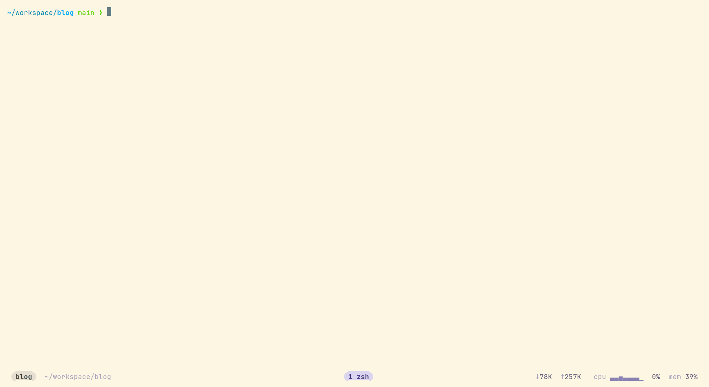

# tm

[English](README.md)

个人用的 tmux 管理插件：一个 fzf 弹窗，用来在 session 和窗口之间切换、新建、
改名、关闭，并在有 Claude Code / Codex 的窗口上用绿点或黄点显示它是在工作还是在等你。
在 tmux 外运行 `tm` 可以选一个项目，直接进入它的 tmux session。
Rust 单二进制，每个按键只跑一次几毫秒的子命令。



`prefix + w` 列出窗口并预览，agent 在工作的窗口亮绿点，在等你的亮黄点；
输入 `learn` 回车，跳到等待中的 Claude；`prefix + f` 把 `~/workspace/tmux-manager` 打开成新 session。

## 安装

依赖 tmux 3.3+ 和 fzf 0.74.3+。

用 [TPM](https://github.com/tmux-plugins/tpm) 的话，加上插件后按 `prefix + I`：

```tmux
set -g @plugin 'zhu-jiyuan/tmux-manager'
```

插件会把对应平台的 release 二进制下载到脚本旁边，用 GitHub 公布的 digest 校验；
没有对应平台的 release 时用 cargo 编译。`prefix + U` 更新插件时二进制一起更新。

手动安装：`cargo build --release`，或从 Releases 下载对应平台的 tarball 解压。
然后在 tmux 配置里加一行并重载：

```tmux
run-shell /path/to/tm.tmux
```

想看 agent 的工作 / 等待状态，跑一次 `tm install-hooks`，它会把 hook 合并进
`~/.claude/settings.json` 和 `~/.codex/hooks.json`（先备份）。

## 键位

`prefix + s` 打开 session 列表，`prefix + w` 打开窗口列表，`prefix + f` 打开项目
列表，`prefix + a` 打开 agent 列表。打开后直接打字过滤。

| 键 | 动作 |
|---|---|
| `Ctrl-j` `Ctrl-k` | 移动，`Ctrl-f` `Ctrl-b` 翻页 |
| `Enter` | 切换过去；没有匹配时新建同名 session |
| `Tab` | 在 session / 窗口 / 项目 / agent 列表之间轮换 |
| `Ctrl-o` `Ctrl-r` `Ctrl-x` | 新建 / 改名 / 关闭，都在输入行内完成 |
| `Ctrl-s` | 收藏，置顶 |
| `Ctrl-l` | 预览下一个窗口 |
| `Ctrl-v` `Ctrl-t` | 开关预览 / 全屏预览 |
| `Ctrl-/` | 键位提示 |
| `Esc` | 关闭 |

选项：`@tm-session-key`、`@tm-window-key`、`@tm-project-key`、`@tm-agent-key`、
`@tm-projects`、`@tm-switch-width`、`@tm-switch-height`、`@tm-bin`，写在
`run-shell` 之前。

## 在终端里

`tm` 直接在终端里打开同一个列表，默认是项目列表，没设 `@tm-projects` 时是
session 列表；`--sessions`、`--windows`、`--projects`、`--agents` 指定列表。在 tmux 里
`Enter` 切换过去；在 tmux 外则 attach 到选中的 session，没有 session 就新建，
tmux 服务没在运行时一并启动。

## 项目

把 `@tm-projects` 指向存放项目的目录，`prefix + f` 就会列出其中的项目，开着的和
没开的都有。`Enter` 切换到项目的 session，没有就以该目录为工作目录新建一个。

```tmux
set -g @tm-projects "~/work ~/oss:2"
```

每个根目录默认扫一层，`:N` 指定层数，隐藏目录跳过。session 按启动目录归属项目，
用别的方式开的也能对上。没有匹配时输入一个路径按 `Enter` 直接打开它。没设这个
选项时 `prefix + f` 保持 tmux 原来的功能。这个选项写在 tmux 配置里，所以在
tmux 外、服务没在运行时，`tm` 会先启动服务来读取它。

## Agent

`prefix + a` 列出所有正在运行或在等你的 Claude Code / Codex pane，等你的排在
前面。每个 agent 占两行：第一行是状态点和会话标题（没有标题时显示目录），第二行
是 harness、pane 的位置（`session:window`，窗口分屏时加 `.pane`）、目录，以及
它在等什么、等了多久：`permission`、`question`、`done` 或 `error`。输入时两行
都参与搜索，移动和选择都以整项为单位。`Enter` 直接跳到那个 pane，预览显示的也
是它，顶部是 agent 的状态；`Ctrl-x` 关掉它，agent 也随之结束。原因和时长来自
hook，所以先运行 `tm install-hooks`；没装 hook 时只有屏幕上出现提问或额度提示
才能看出原因。
